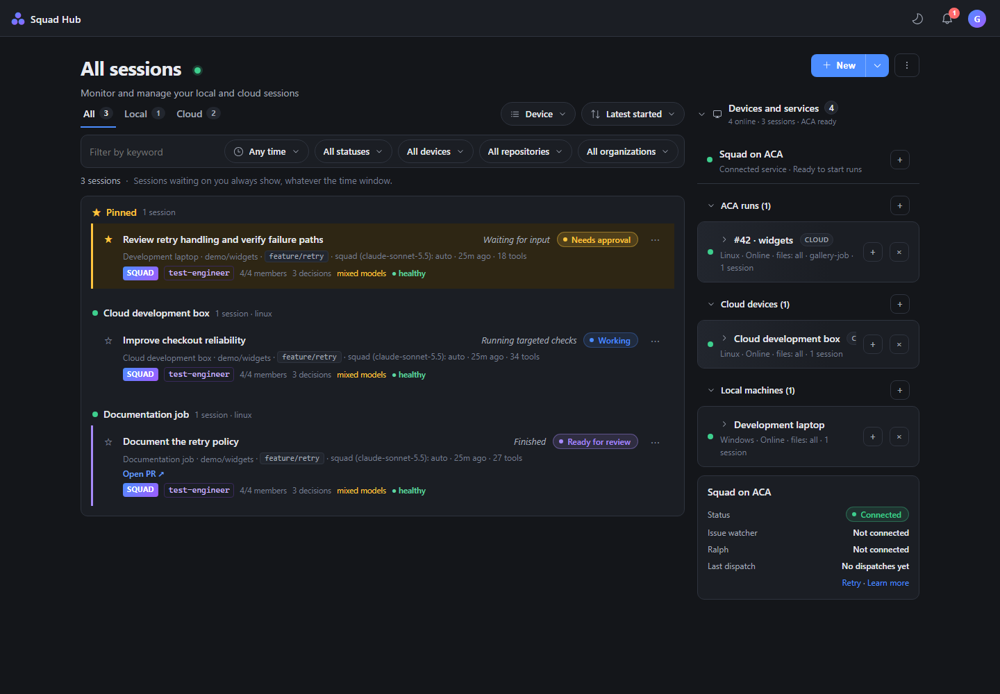
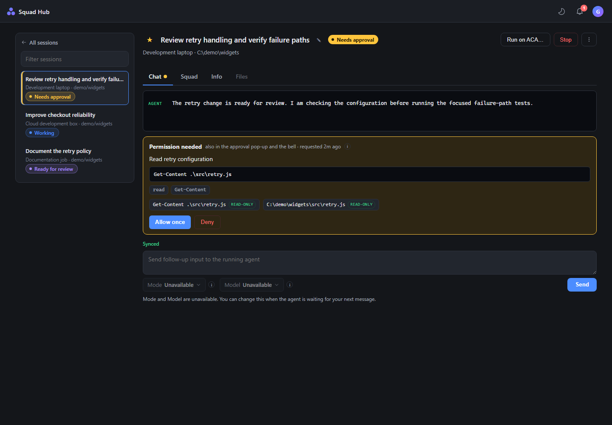
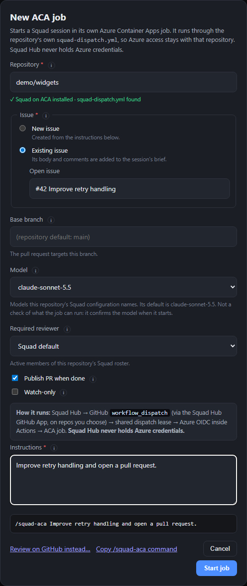
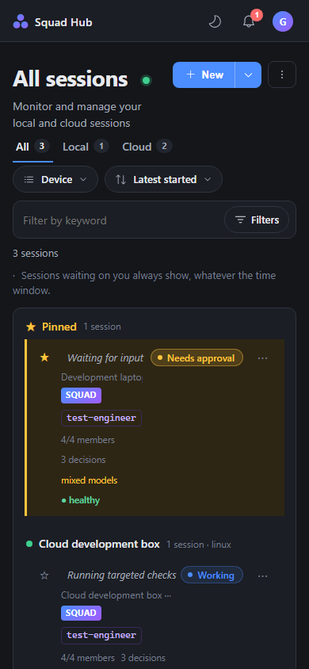
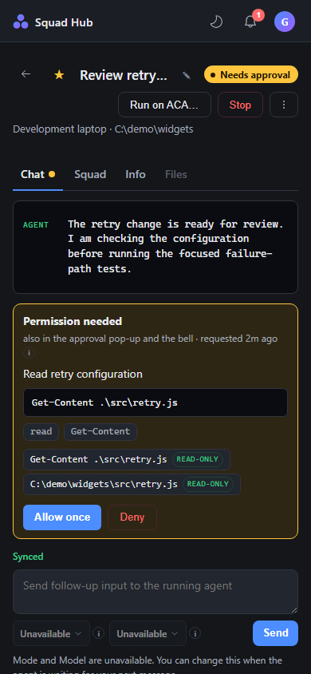
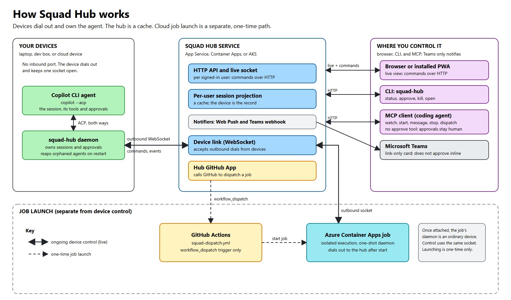

<p align="center">
  
</p>

<h1 align="center">Squad Hub</h1>

<p align="center">
  One place to see and control your <a href="https://github.com/bradygaster/squad">Squad</a> sessions —
  on your laptop, a dev box, an Azure Container App, or a Kubernetes pod.
</p>

---

## The problem

Squad sessions run in more places than one person can watch. Two things go wrong
the moment you step away from a keyboard:

1. **You lose sight of what is running.** There is no single view.
2. **Agents stall.** A session that pauses for tool approval waits until you
   return to *that machine*. On a 45-minute run that is the difference between
   finishing and not.

Squad Hub fixes both.

## What it does

| | |
|---|---|
| **See everything** | One live list of every session, grouped by device |
| **Device presence** | Online, stale, or offline, from a heartbeat |
| **Answer approvals remotely** | The card shows the literal command and the paths it touches; Allow or Deny from the browser, or with `squad-hub approve` |
| **Start a session anywhere** | Pick a device, write a prompt |
| **Steer and stop** | Send follow-up input, choosing its Mode and Model where the agent supports it, or cut a run short |
| **Device tokens** | Give a server a credential that can be a device and nothing else |
| **Squad-aware** | Reads Squad's resolved state for team, decisions, routing, model policy, and health summary |
| **Filter, sort, pin** | Instant list controls, plus pins, custom names and a saved view synced for each signed-in user |
| **Dispatch an ACA job** | A GitHub App can call `workflow_dispatch` on repositories where the App is installed and the hub authorizes dispatch, to launch an isolated cloud run. This is a one-time job launch, separate from ongoing device control |
| **Teams notifications** | An Adaptive Card links to the session when an agent asks for permission, and a short follow-up posts when it is answered or expires. Teams does not approve inline |
| **Drive it from an agent** | `squad-hub mcp` exposes sessions, transcripts, devices and ACA dispatch as MCP tools. There is no approve tool; approvals stay with a human |
| **On your phone** | Installable as a PWA |

## What it looks like

These captures use **synthetic demo data**, not production deployment photos.
Device presence, PR links, health and connection responses are fixtures. See
[capture provenance and limits](docs/README.md#readme-gallery).

**One cockpit for local, cloud and ACA sessions.** All / Local / Cloud scopes,
instant filters, pinned work and a device rail keep the useful context in view.
An approval is edged in amber; a reported PR makes ended work easy to find.

<p align="center">
  
</p>

**A session gets its own page.** The sidebar, Chat / Squad / Info tabs and inline
approval keep the transcript and the **literal command** together. In this
synthetic read-only request, Mode and Model correctly wait until the agent is
ready for the next message. Files is a disabled design placeholder.

<p align="center">
  
</p>

**Prepare an ACA run without leaving the Hub.** Choose an App-installed
repository, an existing issue or a new one, and instructions. This synthetic
dialog is a preview only: **Start job was not pressed**, and no GitHub issue or
Azure run was created.

<p align="center">
  
</p>

**The same work, phone-sized.** The list and session page below are real
390px Chromium viewport captures of the same synthetic fixtures. They show
responsive layout, not an installed phone app or closed-app push delivery.

<p align="center">
  
  
</p>

These captures do not establish production Hub-to-ACA runs or closed-app Web
Push delivery on an installed app.

## Try it

**You need:** Node 18+, and the [GitHub Copilot CLI](https://github.com/github/copilot-cli)
on your PATH — that is the agent Squad Hub supervises.

There is **nothing to build and nothing to install**. Squad Hub has no
dependencies, so there is no `npm install` step and no `node_modules`.

> **Squad is not bundled with this, and is not pinned to a version.** Squad Hub
> supervises whatever the Copilot CLI on your PATH already has. It detects a
> Squad project from `.squad/` or `.github/agents/squad.agent.md` on disk, then
> asks for the `squad` agent **over the ACP protocol** against the list that
> session advertises — so you always get the Squad you have installed, and
> upgrading Squad needs nothing from Squad Hub. If the agent it asked for is not
> there, the session runs with the default and **says so**, rather than quietly
> substituting.
>
> `squad-hub doctor` can also ask Squad about project health, but only when a
> separate `squad` CLI version 0.13 or newer is on `PATH`. Without it, doctor
> reports the specific reason health is unavailable.

### Getting the `squad-hub` command

Three ways, easiest first. All of them give you the same command.

**1. Run it without installing anything.** `npx` fetches, caches and runs it:

```bash
npx squad-hub squad
```

**2. Install it globally**, so `squad-hub` is on your `PATH` for good:

```bash
npm i -g squad-hub
squad-hub squad
```

**3. Clone it**, if you intend to change it — see
[`npm link`](#what-npm-link-actually-does) below:

```bash
git clone https://github.com/swigerb/squad-hub
cd squad-hub
npm link
```

> The package is also published as **`@mightybs/squad-hub`**, which is the same
> code under the org's namespace — use it if you prefer a scoped dependency.
> To run the unreleased `main` instead of the last release, both npm commands
> take `github:swigerb/squad-hub` in place of `squad-hub`.

### Then, whichever way you got it

The recommended workflow, once you have a hub — either one already hosted for
your team, or one you started yourself with `serve` below:

```bash
squad-hub connect --hub <url> --token <device-token>  # once, per machine

cd my-project
squad-hub squad                                       # every time after that
```

`squad-hub squad` starts the daemon if it is not already running, picks the
Squad custom agent automatically in a Squad project (see
[docs/commands.md](docs/commands.md#agent-selection)), and opens an
interactive terminal on a new session — or, given a prompt
(`squad-hub squad "implement issue 42"`), starts that session and returns.

### What `npm link` actually does

This applies to the **clone** route only; `npx` and `npm i -g` do not need it.

It creates **one global symlink** — `squad-hub` on your `PATH` — pointing at
this checkout. That is it. It does not install anything into the checkout,
does not run a build, and does not start anything. Every `squad-hub …`
afterward runs the exact code in this clone, with no `node …` prefix required.
It is a developer-installation step, run **once**, not something that starts a
service — `squad-hub connect`/`squad-hub start` do that.

Without `npm link`, run the same commands as `node bin/squad-hub.js …` instead
of `squad-hub …`.

### Hosted hub vs. running one yourself

Most people never run `squad-hub serve`. A production or team hub is normally
already hosted somewhere (an Azure App Service, a Container App — see "Running
it in the cloud" below), and connecting to it is the one-time
`squad-hub connect --hub <url> --token <device-token>` above. Get that command,
with a fresh token already filled in, from the hub's own account menu →
**Connect a device**.

Run `serve` yourself only if you want a **local** hub — for example, to try
Squad Hub before your team deploys one:

```bash
node bin/squad-hub.js serve
```

It prints a URL containing a token — open that, and you are signed in. It also
prints the exact `connect` command for this device. In a **second terminal**,
in the same folder:

```bash
node bin/squad-hub.js connect --hub http://localhost:7420 --token <token>

cd /path/to/your/project
node /path/to/squad-hub/bin/squad-hub.js squad "add a health endpoint and a test for it"
```

When the agent asks to run something, the approval card appears in the browser —
on your desktop, or your phone — **and** in the interactive terminal if you
have one open on that session. The bell in the top bar lists everything across
every session that needs you right now — a pending approval you can Allow or
Deny inline, or a session that finished a turn and is waiting on your reply —
so you never have to scroll a device-grouped list hunting for the one row
that's stuck.

Everything works from the CLI too:

```bash
squad-hub status          # sessions, and what each is waiting for
squad-hub sessions        # every session, across every device, filterable
squad-hub doctor          # diagnose the whole setup end to end
squad-hub approve <session> <approval> allow_once
squad-hub kill <session>
squad-hub open <session>  # open it in the browser
```

## How it works

<p align="center">
  
</p>

Traffic falls into three kinds, and they are kept apart:

- **Device control (ongoing, live).** The daemon dials **out** to the hub and
  keeps one WebSocket open, so nothing has to be opened on your laptop or dev
  box. Commands (approve, steer, stop) go down that socket and events come up
  it. The daemon speaks ACP both ways with the `copilot --acp` process it owns.
- **Watching and commanding.** A browser or installed PWA gets a live view over
  a WebSocket and sends commands over HTTP. The CLI and the MCP server use the
  same HTTP API. Web Push and Teams notifications are sent by the hub. The Teams
  card links to the session; it does not approve inline.
- **Job launch (one time).** The hub's GitHub App calls `workflow_dispatch` on
  `squad-dispatch.yml`, which starts an isolated Azure Container Apps job. That
  job's daemon then dials out to the hub like any other device.

### The hub is a cache. The device is the record.

The daemon owns the agent, the session, and any pending approval. The hub holds
only a projection of that, so a browser has something to render and command.

**You can restart or redeploy the hub while sessions are running.** The agent
never notices — its connection is to the daemon on the same machine, which never
went away. A pending approval reappears in about two seconds, with the same id,
and answering it still runs the tool.

A daemon restart is different: it reaps its agents deliberately, because an
unsupervised agent holding a repository checkout is worse than no agent. Those
sessions are gone, and the hub correctly shows none rather than offering
approvals nobody can answer.

The full matrix of what survives what is in
[docs/architecture.md](docs/architecture.md).

## Running it in the cloud

The simplest option is **Azure App Service** — native Node, no container:

```powershell
./scripts/deploy-appservice.ps1 -ResourceGroup rg-my-hub -Name my-squad-hub `
  -AuthMode github -Owner your-github-login
```

`-Owner` is not optional in practice. A hub can start sessions and approve
commands on your machines, so the script **refuses to deploy without one** (or
`-AllowedUsers`, or an explicit `-AllowAnyone`) rather than putting an open hub
on a public hostname.

The resource group is created if it does not already exist. The deploy uses
your active `az` subscription and prints which one; pass `-Subscription` to pin
it.

The script refuses to deploy a configuration that cannot carry a device, and
verifies the build it pushed is the one serving.

Container Apps and Kubernetes are also supported, and can additionally run a
**cloud device** — a daemon in the cloud that appears in the device list beside
your laptop:

```powershell
./scripts/deploy-aca.ps1 -ResourceGroup rg -Environment cae -Registry acr -WithCloudDevice
./scripts/deploy-aks.ps1 -ResourceGroup rg -Cluster aks -Registry acr -HubUrl https://... -HubToken ... -AgentToken ...
```

Give a cloud device a GitHub token and it runs a real agent:

```
SQUAD_HUB_URL          the hub service
SQUAD_HUB_TOKEN        identifies the DEVICE to the hub
SQUAD_HUB_AGENT_TOKEN  authorises the AGENT to GitHub
```

Those last two are deliberately separate. The hub token says which device this
is; the agent token spends a Copilot entitlement. Conflating them would let
anyone who can register a device also spend someone else's.

A container that already knows what to run — a Container Apps job execution —
can run one session and exit, so it does not bill for a process doing nothing:

```
SQUAD_HUB_ONESHOT=1
SQUAD_HUB_PROMPT="add a health endpoint and a test for it"
```

Add `SQUAD_HUB_MODEL=<name>` and `SQUAD_HUB_REQUIRE_MODEL=1` to pin a model: the
agent must confirm it before the prompt is sent, or the job exits 78 instead of
quietly running on the default. `squad-hub oneshot --capabilities` says whether
a build understands that, without starting anything.

That is how Squad Hub supervises [Squad on ACA](docs/aca.md) runs, which lets a
tool call inside a cloud job be approved from your phone — something an
unattended job cannot do.

See [docs/cloud.md](docs/cloud.md).

## Security

**Lock it to yourself.** A hub can start sessions and approve commands on your
machines, so the deploy script **refuses to deploy without an owner**:

```powershell
./scripts/deploy-appservice.ps1 -ResourceGroup rg -Name my-hub `
  -AuthMode github -Owner your-github-login
```

**More than one account?** List them all — they share one view:

```powershell
-Owner you@work.example,you@personal.example
```

Partitioning is keyed on tenant + object id, so two accounts of the same person
would otherwise be two separate hubs sharing a URL. `-Owner` says *these are all
me*. Use `-AllowedUsers` for other people, who each keep their own devices.

A tenant filter is not an owner filter — every user in that tenant would
otherwise be permitted. The check is enforced on the device WebSocket as well as
the API, since registering a device is what an intruder would actually want.

**Give a server a device token, not your own credential.** A device token can be
a device and nothing else: it cannot read the API, start work on your other
devices, or watch your sessions. It expires, it can be revoked, and it can be
restricted to device ids with a given prefix — so a token for cloud jobs cannot
claim to be your laptop.

```bash
squad-hub device-token --hub <url> --token <yours> --label "build server" --ttl-hours 24
```

**File access is off by default.** No folder picker, no directory browsing,
until you opt in:

```bash
squad-hub start --allow-files       # scoped to the launch directory
squad-hub start --allow-files-all   # the whole filesystem
```

The confinement root is enforced by the daemon and **never leaves the device** —
the service is told only whether file access is on and whether it is scoped.

**External Squad state is opt-in.** Squad 0.13 can keep state outside the opened
project through `teamRoot` or `stateLocation: "external"`. Squad Hub resolves
those layouts, but by default it will not read a Squad state root outside the
project. Enable `followExternalSquadState` only in Squad Hub's own config, and
only when this device should trust the repository's pointer to that external
team state.

**Per-user isolation** is structural, not a filter applied at read time. Every
lookup reaches into one subject's partition, so there is no code path that
returns another user's data and then remembers to remove it.

See [docs/security.md](docs/security.md).

## A constraint worth knowing up front

**The Hub has to start the session.** There is no supported way to attach an
ACP client to a `copilot` process someone already launched by hand — running
`copilot`, then picking the Squad custom agent with `/agent`, produces a
session with no ACP surface for anything else to attach to. That is why
`squad-hub squad`/`squad-hub run` launch `copilot --acp` themselves, from the
very first prompt, with the Squad agent selected automatically when the
project calls for it (`--agent squad`) — the daemon owns the process from the
start instead of trying to attach to one later.

## Keep it running at login (optional)

```bash
squad-hub install-service   # Windows Task Scheduler / systemd --user / LaunchAgent
squad-hub uninstall-service
squad-hub service-status
```

Registers a login task that runs `squad-hub start` once at sign-in, so the
daemon is already up the next time you need it. Never requires admin or root.
See [docs/commands.md](docs/commands.md#login-startup-optional).

## Testing

```bash
npm test              # the suite
node test/mutate.js   # break each mechanism, require a named test to fail
```

Two rules the suite follows:

**Assert side effects, not replies.** An approval test checks for a file the
agent could only create by actually running the command. An agent that ran a
denied command would report the denial just as convincingly.

**A test that cannot fail is decoration.** `test/mutate.js` disables each
load-bearing mechanism in turn and requires the test that claims to cover it to
fail *by name*. A mutation nothing catches is a mechanism nothing tests.

More in [`docs/`](docs/).

## How it is built

Built on public specifications: the
[Agent Client Protocol](https://agentclientprotocol.com) and GitHub Copilot
CLI's published flags. For how the protocol and verification scripts are
checked, see the [developer verification docs](docs/README.md#verification-scripts).

**No dependencies.** Every `require` is a Node builtin — the WebSocket
implementation included. There is no `npm install`, no `node_modules`, and no
build step for the web app.

## License

MIT.
