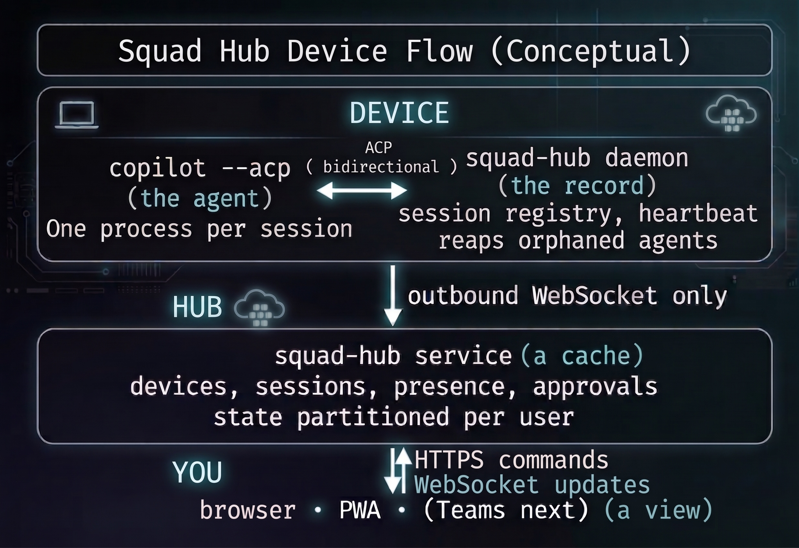

# Architecture

## The hub is a cache. The device is the record.

This is the single idea worth understanding, because it explains almost every
operational behavior below.

The **device daemon** owns everything real: the agent process, the session, and
any pending approval. The agent's request for permission is an open RPC to the
daemon on the same machine.

The **hub service** holds only a projection of that, so a browser has something to
render and something to command. By default it persists the projection under
`SQUAD_HUB_HOME` when that directory is writable, and otherwise keeps it in memory;
pending approvals are never persisted.

  

Three roles, and the distinction between them is the whole design:

| | | |
|---|---|---|
| device daemon (started by `squad-hub start` or `connect`) | **the record** | on the device, alongside the agent |
| hub service (`squad-hub serve`) | **a cache** | in the cloud, per-user, persisted under `SQUAD_HUB_HOME` when writable |
| browser · PWA · Teams | **a view** | HTTPS to command, WebSocket to watch |

### Device kind

The daemon reports only `local` or `cloud`. The hub decides whether the roster
shows `local`, `cloud`, or `aca`: an `aca-` device id (see
[`aca.md`](aca.md)), or cloud metadata naming an ACA execution/job, promotes a
cloud device to `aca`.

The device rail separates the **Squad on ACA** service shortcut from **ACA
runs**, the individual workers that have attached. A verified GitHub App
connection adds one ACA service to the rail's connection count, even before
a run starts. The count's tooltip distinguishes that service from device
records. An unconfigured or unreachable service adds nothing; this does not
create a device or session in the Hub API.

That metadata (`displayName`, `repo`, `issue`, `executionName`, `jobName`,
`role`, `approvalMode`, `lastSweepAt`) is optional, validated and size-capped
in [`src/device-meta.js`](../src/device-meta.js), and never trusted as sent.
`role`, `approvalMode` and `lastSweepAt` are further restricted to
closed vocabularies -- the "Squad on ACA" status card (`web/js/aca-status.js`)
treats them as VERIFIED facts a device chose to report, never guesses one
from a device's own `name`, and reports plain presence or a bare heartbeat
when a device sends none of them.

### Session activity and pull requests

Each session carries `lastActivityAt` (epoch ms), used for "Latest/First
updated" sorting. It is deliberately not the same signal as a session's
`updatedAt`: a device re-sends its whole session list on every heartbeat and
reconnect (see "What follows from it" below), which would refresh `updatedAt`
for sessions that have done nothing. `lastActivityAt` instead moves only on a
real status change or new tool calls (a higher `toolCallCount` than the
device last reported), so an hour of silence still reads as an hour of
silence after the next heartbeat tick, and a busy session reads as busy.

A session may also carry an optional `pullRequest` the device reports --
`{ url, number, title }` -- naming a pull request its work produced or is
aimed at. Validated with the same posture as device metadata, in
[`src/pull-request.js`](../src/pull-request.js): `url` must be a real GitHub
pull request URL, `number` the positive integer in that URL, and `title`
capped at 200 characters. Unlike device metadata's independent fields, a pull request is one
fact with three parts, so an invalid field rejects the whole thing rather than
surviving with a dropped piece.

**Ready for review** is not a status a device reports; it is derived, by
[`src/session-status.js`](../src/session-status.js) on the hub and by its mirror
in `web/js/util.js` in the browser (a unit test runs both against one matrix).
A session is ready for review when it has *ended* (`done`, `failed`, `stopped`
or `disconnected` -- a pull request attached to a session that is still working
or idle is not ready for anyone), reports a *valid* `pullRequest`, and has *no
pending approval*. The web app draws it as a violet pill, a violet row edge and
an "Open PR ↗" link that opens GitHub in a new tab, and offers it as a Status
filter once a session qualifies. A session's Squad `health` verdict is drawn as
a "● healthy" or "● health: N failing" badge on its Squad line, with the
per-check list on the session's detail page.

### What follows from it

**You can redeploy the hub in the middle of a working day.** The agent never
notices — its connection is to the daemon, which never went away.

**A device that cannot reach the hub keeps working.** It just cannot be seen or
commanded until it reconnects.

**The hub can never lie about a session for long.** Devices re-send their whole
session list on reconnect and on every heartbeat, and the service *replaces*
rather than merges, so anything that has stopped existing disappears.

## What survives what

The first row is enforced by [`test/restart-unit.js`](../test/restart-unit.js).

| Event | Sessions | A pending approval | Devices |
|---|---|---|---|
| **Hub service restarts / redeploys** | reloaded from disk when `SQUAD_HUB_HOME` is writable; republished by devices when they reconnect | **survives** on the device, same id, still answerable once it republishes | re-register |
| **Daemon restarts** (`squad-hub stop`/`start`) | **lost** — agents are reaped | lost with its session | re-registers, online |
| **Daemon killed** (crash, network, laptop lid) | live sessions marked **disconnected** when the socket closes; a reconnect republishes what is still live | expired with reason `device disconnected`; a reconnect republishes any still pending | online → stale → offline |
| **Agent process dies** | marked **failed** within one heartbeat | cleared | unaffected |
| **Browser closed** | nothing lost | nothing lost | nothing lost |

### The hub restart, in full

A restarted service reloads its session records from `sessions.json` under
`SQUAD_HUB_HOME` when that directory is writable; `/healthz` reports
`sessionStore` as `"durable"` or `"memory"`. Pending approvals are never written
to disk, and with no writable directory the store starts empty. Each device
reconnects with exponential backoff (1 s, 2 s, 4 s, and so on, capped at 30 s)
and republishes its sessions, including pending approvals. The approval id is
unchanged, so a card already open elsewhere still answers the right thing, and
answering it after the restart runs the tool.

### The daemon restart, in full

Sessions are **not** recovered, and that is deliberate. A daemon reaps its agents
on shutdown, because an unsupervised `copilot --acp` holding a repository
checkout — invisible to every surface — is worse than no agent at all.

After a daemon restart the agent process is gone, the hub shows no sessions for
the device and no pending approval, and the device re-registers and shows online.
The hub does not show ghosts: a session list offering approvals that can never be answered would be worse than
an empty one.

### A device that vanishes

Presence decays on a timer rather than disappearing at once, because a laptop
lid and a crashed daemon look identical from the hub:

`online` → `stale` → `offline`, then dropped from the roster entirely if it stays
away and has no sessions worth remembering.

## What is genuinely not durable

**Pending approvals.** A pending approval lives only on the device, because it is
an open request to a specific agent process. The hub never writes it to disk; it
holds a copy only while the device is connected and the device republishes it on
reconnect.

**Sessions after a daemon restart.** The daemon holds its sessions in memory and
reaps its agents on shutdown, so once it restarts the device no longer reports
them and the hub drops its copy on the next sync.

## Per-user preferences

Pins, renames and the saved view (`GET`/`PUT /api/prefs`, see
[api.md](api.md#get-apiprefs-put-apiprefs)) are a user's own settings, not the
hub's operational state, so they follow the same "whole record, every time"
persistence rule as sessions and access grants rather than living in the `Store`
above: a file of their own (`prefs.json` under `SQUAD_HUB_HOME`, see
[security.md](security.md#where-state-is-kept)), keyed on the caller's verified
partition. `/healthz` reports `prefsStore: "durable"` once a deployment persists
it, for the same reason `sessionStore` and `accessStore` do -- so a hub pointed
at an unwritable or unset `SQUAD_HUB_HOME` says so before a redeploy silently
forgets every saved view, rather than after.

## One instance only

State is per process. Two instances means a device attaches to one of them and
the other reports zero devices — roughly half of all requests fail,
intermittently.

`/healthz` reports the instance count, the startup log says so loudly, and the
UI shows a banner. The App Service deploy script refuses to deploy a plan with
more than one worker.

**Scale up, not out.** For one person's devices, one instance is ample.

## Why one agent process per session

A single ACP client *can* drive several sessions concurrently; see
[`spike/acp-capability-probe.js`](../spike/acp-capability-probe.js).

The daemon spawns one process per session anyway, because multiplexing means a
single crash takes every session on the device with it, and it turns "stop this
session" into a protocol problem instead of a `kill()`.

## Re-adopting a session

`session/load` lets a new client load a session an old one started, replay its
transcript, and prompt it.

The model's context does **not** survive: a fact stated before the restart is
not recalled afterwards.

So re-adoption recovers the *session*, not the *conversation*. The daemon
therefore reaps on restart rather than pretending nothing happened.

## Security boundaries

**File access is off by default.** The confinement root is enforced by the
daemon and is never sent to the service — the heartbeat reports only whether
file access is on and whether it is scoped.

**Per-user isolation is structural**, not a filter applied at read time. Every
lookup reaches into one subject's partition, so there is no code path that
returns another user's data and then remembers to remove it.

**Two tokens, deliberately separate.** `SQUAD_HUB_TOKEN` identifies the *device*
to the control plane; `SQUAD_HUB_AGENT_TOKEN` authorises the *agent* to GitHub.
Conflating them would let anyone who can register a device spend someone else's
Copilot entitlement.

## Keepalive

Proxies close connections that carry no traffic. Azure App Service does so at
about 240 seconds, and it is far from alone.

Two WebSockets are at risk, and they fail differently:

- **The device's outbound socket** carries a heartbeat every 15 s, so it is
  never idle.
- **The browser's watcher socket** only *receives*. On an idle hub it would send
  and receive nothing, and a proxy would drop it and show stale data until it
  reconnected.

The service pings every 45 seconds. Two bytes, and browsers answer
automatically.

This is the reason the browser's connection is worth naming separately in the
diagram above: commands travel over HTTPS and would be fine either way, but live
updates depend on a socket that nothing else was keeping open.

## Web UI modules

`web/app.js` holds the import list and `main()`, the startup sequence (sign-in
check, initial load, deep-link resolution and the refresh timer). The rest of the
client is split by feature under `web/js/`, and the styles under `web/css/`.
There is no bundler and no build step: the browser resolves plain
`<script type="module">` imports itself.

| Area | Modules in `web/js/` |
|---|---|
| State, API and helpers | `api.js` (`state`, `api()`, token storage), `util.js`, `ws.js` (the live WebSocket connection), `wiring.js` (wires every control once at startup) |
| Session list | `list.js`, `sessionrow.js`, `rowmenu.js`, `filters.js`, `dropdowns.js`, `prefs-sync.js`, `empty-state.js`, `review.js` |
| Approvals and notifications | `approvals.js`, `approval-card.js`, `inbox.js`, `notifications.js`, `push.js`, `install.js` |
| Session page | `detail.js`, `detail-tabs.js`, `detail-control.js`, `session-info.js`, `squad-panel.js`, `transcript.js`, `composer.js`, `composer-wire.js`, `next-turn.js` |
| Devices | `devices.js`, `device-detail.js`, `connect.js`, `access.js`, `forget.js`, `cleanup.js` |
| Run on ACA | `aca.js`, `aca-choices.js`, `aca-created-issue.js`, `aca-match.js`, `aca-pending.js`, `aca-rail.js`, `aca-status.js`, `combobox.js` |
| Sign-in | `signin.js` |

New files are added to the `SHELL` cache list in `web/sw.js`, with a cache-name
bump, so an installed app picks them up. `test/package-unit.js` keeps every file
under `web/js/` and `web/css/` below a 25,600-byte budget.
